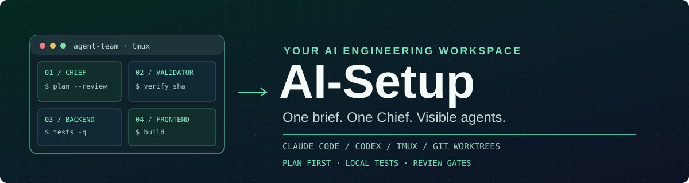
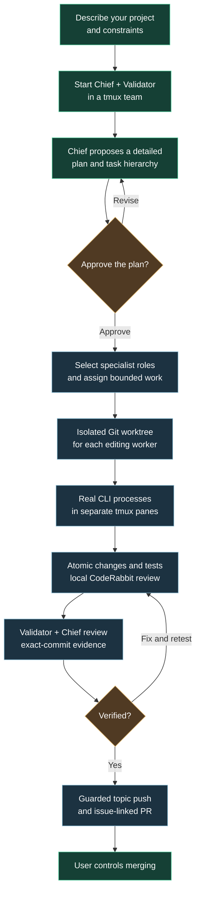
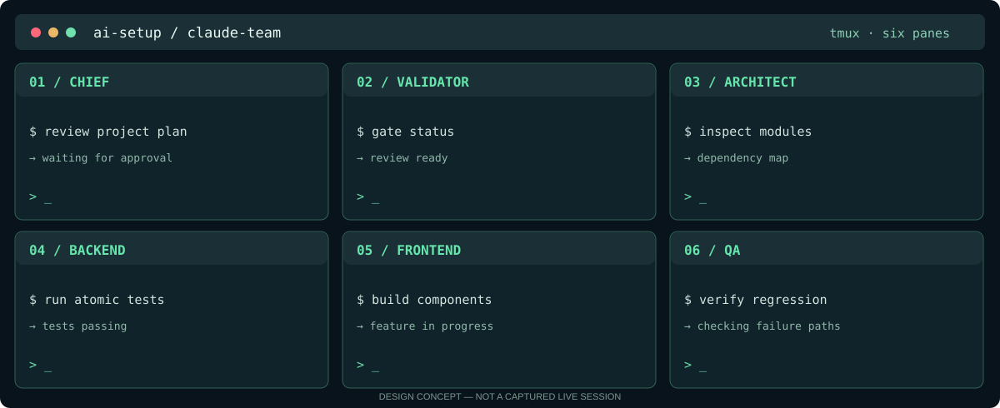

<div align="center">



<br />

**A portable Claude Code + Codex engineering-team setup**

*Shared rules · twelve specialist roles · 120 focused skills · visible tmux agents*

[](INSTALLATION.md)
[](team/ROSTER.md)
[](team/README.md)
[](REVIEW.md)

[**Quick start**](#quick-start) · [**How it works**](#how-it-works) · [**Agent roster**](#meet-the-team) · [**Install options**](#install-options) · [**Documentation**](#documentation)

</div>

---

> [!IMPORTANT]
> **AI-Setup is a public setup kit—not a hosted AI orchestration service.** It configures local tools and launches Claude-only or Codex-only teams inside tmux. Interactive end-to-end model-team startup has not been fully validated in the repository's local test suite; provider login, model availability, trust prompts, and tmux behavior depend on your installation.

## What is AI-Setup?

AI-Setup gives Claude Code and OpenAI Codex a common operating environment: shared engineering standards, **12 named specialist roles**, **120 skills** (ten per role), and `claude-team` / `codex-team` commands. Chief plans the work and waits for your approval, Validator independently checks results, and editing agents work in **separate Git worktrees**.

| Principle | Behavior |
|:--|:--|
| **Plan before code** | Chief proposes project scope, architecture, dependencies, stack and acceptance criteria |
| **Visible agents** | Each team member gets a native CLI process in its own tmux pane |
| **Explicit ownership** | Editing workers use independent topic branches and worktrees |
| **Atomic verification** | Focused local tests, CodeRabbit review and commit-bound evidence |
| **Review-gated publication** | The local push helper checks two approval records and an exact SHA; merges remain user-controlled |
| **Portable configuration** | Dry runs, backups, restore, WSL mirroring and optional YOLO settings |

## Quick start

### Option A — Let Claude Code or Codex guide installation

```bash
git clone https://github.com/EvanGUTK/AI-Setup-public.git
cd AI-Setup-public
claude                  # or: codex
```

Then tell the agent:

> **Implement this setup in my system. Start with a dry run, explain proposed changes, and ask before installing.**

The repository's `CLAUDE.md` and `AGENTS.md` describe the installation procedure. Authentication is manual.

### Option B — Install directly

```bash
./install.sh --dry-run    # Preview changes; writes nothing
./install.sh              # Interactive installation
# Open a new shell to reload the launchers
agent-team doctor         # Dependency and configuration checks
```

For Windows, run the shell installer **inside Ubuntu/WSL2**, then run `.\install.ps1` from Windows PowerShell to add the Windows launcher integration. Review [full installation instructions](INSTALLATION.md), including backups and restore, first.

## How it works



The workflow is **guided and prompt-driven**, not a separate scheduler guaranteeing automatic agent startup. The Chief's bootstrap prompt instructs it to start Validator first, wait for its acknowledgment, propose a deep plan and obtain user approval before delegation. Team messaging uses durable mailbox files and pane notices.

### Inspect the team, not twelve chat tabs

<div align="center">



<sub>Concept illustration; not a captured live session.</sub>

</div>

The default limit is **six panes per tmux window** (`AGENT_TEAM_MAX_PANES`). Additional agents open in another window in the same session. A Claude team is Claude-only; a Codex team is Codex-only. Different providers don't automatically share one internal message bus.

## Meet the team

Twelve installed role definitions each have ten accompanying personal skills. Chief selects useful specialists after plan approval rather than launching everyone indiscriminately.

| Role | Specialization | Role | Specialization |
|:--|:--|:--|:--|
| **Chief** | Planning, delegation, user interaction | **Validator** | Independent review and push gate |
| **Architect** | Architecture, contracts, repository design | **Product** | PRDs, journeys, feature scope |
| **Backend** | Services, APIs, backend tests | **Frontend** | UI and interaction |
| **Engine** | Core runtime and algorithms | **Data** | Storage, schema and migrations |
| **QA** | Regression and integration tests | **Security** | Threat modeling and protections |
| **Platform** | Toolchains and system integration | **Integrator** | Worktrees and merge coordination |

Read the [full roster and all 120 skills](team/ROSTER.md).

## Working with teams

```bash
# Start a team from inside your own project
claude-team "I want to build a scheduling app"
codex-team "Add reporting to this application"

# Inspect environment and running team
agent-team doctor
agent-team panes
agent-team inbox

# Create an isolated editing checkout
agent-team worktree backend reporting

# Inspect exact-SHA local review gates
agent-team gate status
```

For teammates, message routing, pane creation, review records and explicit handoffs, follow [the team guide](team/README.md). The local push helper rejects protected-branch destinations and stale or missing evidence—but **raw Git commands can bypass that helper**; it is a workflow guard, not a system-level security sandbox.

## Install options

| Flag | What it does |
|:--|:--|
| `--dry-run` | Prints expected changes without writing |
| `--yes` | Accepts system-package installation without another prompt |
| `--no-system` | Skips package installation |
| `--yolo` | Opts into permission-bypass defaults where permitted |
| `--home DIR` | Installs under another home for sandbox testing |
| `--windows-home DIR` / `--no-windows` | Controls WSL-to-Windows mirroring |
| `--restore TIMESTAMP` | Restores a recorded backup |

**Permission bypass is OFF by default.** The optional `--yolo` setting can allow a CLI to edit files and run commands without ordinary approval prompts. Use it only in a trusted, contained environment. Organization and project policies may still disallow it.

| Platform | Team sessions |
|:--|:--|
| **Windows / WSL2** | Teams run inside WSL tmux; PowerShell launchers forward team commands |
| **Linux** | Direct terminal + tmux; apt/dnf/pacman prerequisites |
| **macOS** | Direct terminal + tmux; Homebrew supported |

The installer checks Python 3.9+, Git, tmux, GitHub CLI, CodeRabbit and installed Claude/Codex CLIs. ECC and CCPM integration is handled through their supported plugin/skill mechanisms; provider logins are never automated.

## Repository layout

```text
AI-Setup-public/
├── README.md
├── assets/                # Brand artwork and tmux pane diagram
├── install.sh             # WSL, Linux and macOS installation
├── install.ps1            # Windows PowerShell integration
├── team/
│   ├── team.py            # CLI, tmux panes, mailboxes, worktrees and gates
│   ├── build_setup.py     # Role, skill and rules deployment
│   ├── install_launchers.py
│   ├── bootstrap-claude.txt
│   ├── bootstrap-codex.txt
│   ├── models.json        # Requested provider models and effort
│   ├── ROSTER.md
│   ├── UNIVERSAL.md
│   ├── roles/
│   ├── skills/
│   └── README.md
├── tests/                 # Behavioral and installation tests
├── PROJECT.md
├── ARCHITECTURE.md
├── INSTALLATION.md
├── TASKS.md
├── REVIEW.md
├── CLAUDE.md
└── AGENTS.md
```

## Documentation

| Guide | Focus |
|:--|:--|
| [Installation](INSTALLATION.md) | Setup, verification, backup, restore and uninstall |
| [Operator guide](team/README.md) | Starting panes, sending messages, worktrees and Git gates |
| [Architecture](ARCHITECTURE.md) | System boundaries, provider exclusivity, persistence and known limits |
| [Specialist roster](team/ROSTER.md) | All twelve roles and their ten skills |
| [Project definition](PROJECT.md) | Goals, constraints, public repository requirements |
| [Review history](REVIEW.md) | Local CodeRabbit findings, fixes and limitations |
| [Implementation tasks](TASKS.md) | Completed and tracked work |
| [Claude instructions](CLAUDE.md) / [Codex instructions](AGENTS.md) | Agent-facing installation guidance |

### Verify the repository locally

```bash
python3 -m unittest discover -s tests -v
```

The repository does not create remote CI/CD workflows. A passing unit suite or installer doctor check **does not prove** that all configured provider models are available or that a live multi-agent team has completed an end-to-end run.

---

<div align="center">

**One brief. One Chief. Visible agents.**

<sub>Public engineering setup project · No license file detected at time of this README update.</sub>

</div>
